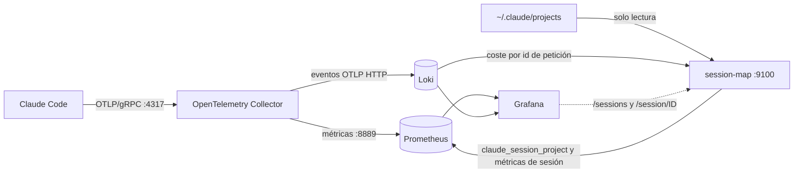
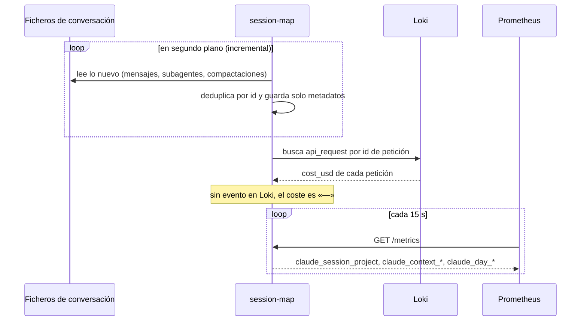

# Infraestructura de métricas de Claude Code

Nov 11, 2026 · Óscar Abal García

## Resumen

Claude Code exporta telemetría OpenTelemetry a una pila local de cinco contenedores (OpenTelemetry Collector, Prometheus, Loki, Grafana y un exportador del mapa sesión → proyecto). Las métricas dicen cuántos tokens se consumen, cuánto cuesta y quién lo usa; los eventos detallan cada llamada al modelo y cada herramienta, para depurar comandos y skills.

Todo corre con Docker Compose en la carpeta del proyecto. Prometheus conserva las métricas 90 días y Loki los eventos 30 días. Hay un único dashboard, «Claude Code», con filas de métricas, de sesiones y de eventos; se filtra por proyecto y usa el selector de tiempo de Grafana.

## Arquitectura

Claude Code envía métricas y eventos al collector. Prometheus lee las métricas del collector, Loki recibe los eventos y Grafana consulta a los dos. Un quinto contenedor, session-map, publica a qué proyecto pertenece cada sesión y Prometheus lo lee también. El log de depuración del collector sigue disponible, en modo `basic`.

## Componentes

Cada pieza hace una sola cosa: Claude Code emite, el collector recibe y reparte, Prometheus guarda métricas, Loki guarda eventos y Grafana dibuja.

| Componente | Qué hace | Puertos | Persistencia |
| --- | --- | --- | --- |
| Claude Code (cliente) | Emite métricas y eventos OpenTelemetry por gRPC cuando `CLAUDE_CODE_ENABLE_TELEMETRY=1`. Añade las etiquetas `team`, `department` y `project` definidas en `OTEL_RESOURCE_ATTRIBUTES`. La app de escritorio no aplica `OTEL_RESOURCE_ATTRIBUTES`: sus sesiones salen sin `project`, que se resuelve con session-map. | sale a `localhost:4317` | ninguna |
| OpenTelemetry Collector (`otel/opentelemetry-collector-contrib`) | Recibe OTLP y lo agrupa por lotes. Expone las métricas en formato Prometheus, convirtiendo los atributos del recurso en etiquetas, y reenvía los eventos a Loki. Su log de depuración (`debug`, `basic`) solo cuenta lo recibido. | 127.0.0.1:4317 (gRPC), 127.0.0.1:4318 (HTTP); 8889 (métricas) solo en la red interna | ninguna: las series caducan a las 24 h sin datos (`metric_expiration`) |
| Prometheus (`prom/prometheus`) | Lee `otel-collector:8889` cada 15 s y almacena las series temporales; motor de consulta PromQL. También lee `session-map:9100`. | 127.0.0.1:9090 | volumen `prometheus-data`, retención 90 días |
| session-map (python:3.13-alpine) | Recorre ~/.claude/projects (montado en solo lectura) y publica claude_session_project{session_id, project}. El proyecto sale del directorio de trabajo (`cwd`) que registra cada sesión; así se atribuyen las sesiones de escritorio. Sirve además las páginas de sesión, el informe de mejoras y los datos de la fila «Mejoras». | 127.0.0.1:9100 | índice en memoria, recalculado al arrancar; historial del informe en el volumen `coach-data` |
| Loki (`grafana/loki:3.4.2`) | Recibe los eventos del collector por OTLP HTTP y los guarda; se consulta con LogQL. Los atributos de cada evento quedan como metadatos estructurados. | 127.0.0.1:3100 | volumen `loki-data`, retención 30 días |
| Grafana (`grafana/grafana`) | Visualización. Los datasources Prometheus, Loki y Coach (plugin Infinity, que se instala al arrancar con `GF_PLUGINS_PREINSTALL_SYNC`) están provisionados; el dashboard se provisiona desde `Grafana/`. La contraseña de `admin` sale de `.env`. | 127.0.0.1:3000 | volumen `grafana-data` |
| Docker Compose | Levanta los cinco contenedores, con `restart: unless-stopped`, y monta los ficheros de configuración en solo lectura. | n/a | n/a |

## Información que podemos obtener

Hoy llegan seis métricas a Prometheus, que se pueden cruzar por proyecto, modelo, esfuerzo, usuario, equipo y sesión.

| Métrica | Qué mide | Etiquetas propias |
| --- | --- | --- |
| `claude_code_token_usage_tokens_total` | Tokens consumidos. | `type` (entrada, salida, caché), `model`, `effort`, `query_source` |
| `claude_code_cost_usage_USD_total` | Coste estimado en USD. | `model`, `effort`, `query_source` |
| `claude_code_session_count_total` | Sesiones de CLI iniciadas. | `start_type` |
| `claude_code_active_time_seconds_total` | Tiempo activo de uso, en segundos. | `type` |
| `claude_code_lines_of_code_count_total` | Líneas de código modificadas, añadidas o eliminadas. | `type` (añadidas o eliminadas), `model` |
| `claude_code_code_edit_tool_decision_total` | Decisiones de permiso (aceptar o rechazar) sobre las herramientas Edit, Write y NotebookEdit. | `decision`, `tool_name`, `language`, `source` |

Etiquetas por las que se puede desglosar:

- **Uso:** `model`, `effort`, `type` y `query_source` (distingue el agente principal de los subagentes).
- **Quién y dónde:** `user_email`, `user_id`, `user_account_uuid`, `organization_id`, y `team`, `department` y `project`, que fijamos nosotros (`project` se define por proyecto, ver Configuración).
- **Contexto:** `session_id`, `terminal_type`, `os_type`, `os_version`, `host_arch`, `service_version`, y atributos de la cuenta como `anthropic_plan`, `anthropic_seat_type` y `claude_deployment_mode`.

**Proyecto por sesión.** `session-map` publica `claude_session_project{session_id, project}`, con el proyecto sacado de las carpetas de `~/.claude/projects` (los worktrees cuentan como su proyecto). Los dos dashboards filtran con la variable oculta `sessions` (`session_id=~"$sessions"`), así que cubren sesiones de CLI y de escritorio, también las anteriores.

El dashboard «Claude Code - Uso y coste» responde a estas preguntas:

- ¿Cuántos tokens y cuánto dinero se gastó en el periodo, y cuántas sesiones hubo?
- ¿Qué modelos y niveles de effort concentran el coste, en total y hora a hora?
- ¿Qué parte de los tokens es entrada, salida o caché?
- ¿Cuánto consumen el agente principal y los subagentes?
- ¿Qué usuario y equipo genera más coste?

**Eventos en Loki.** Además de las métricas, cada llamada al modelo y cada herramienta generan un evento. Todos comparten `prompt_id`, que agrupa lo que pasa dentro de un mismo prompt del usuario.

| Evento | Atributos útiles |
| --- | --- |
| `api_request` | `model`, `effort`, `query_source`, `input_tokens`, `output_tokens`, `cache_read_tokens`, `cache_creation_tokens`, `cost_usd`, `duration_ms`, `ttft_ms` |
| `tool_result` | `tool_name`, `duration_ms`, `success`, `tool_input_size_bytes`, `tool_result_size_bytes` |
| `tool_decision` | `tool_name`, `decision`, `source` |
| `user_prompt` | `prompt_length` (el texto llega con OTEL_LOG_USER_PROMPTS=1, activo desde el 13/11/2026 y solo en sesiones nuevas; antes llegaba redactado) |
| `assistant_response`, `skill_activated` | `skill_name`, `response_length`. `skill_activated` lleva el nombre de la skill, pero las propias y las de plugins salen como `custom_skill` salvo con `OTEL_LOG_TOOL_DETAILS=1` (no activado). |
| `hook_execution_*`, `plugin_loaded`, `mcp_server_connection`, `at_mention` | Arranque de hooks, plugins y servidores MCP, y menciones de ficheros |

Los eventos siguen en Loki y permiten responder a estas preguntas; el dashboard muestra hoy la primera y la de herramientas:

- ¿Cuánto cuesta cada prompt y cuáles son los más caros?
- ¿Cuántas llamadas al modelo hace cada prompt y qué tasa de acierto de caché tiene?
- ¿Cuánto contexto se lee de caché en cada llamada y cómo evoluciona?
- ¿Cuánto consumo de fondo hay (`prompt_suggestion`, títulos de sesión) frente al agente principal?
- ¿Qué herramientas devuelven más bytes al contexto y cuáles tardan más?
- ¿Cuántas activaciones tiene cada skill y cuánto cuestan los prompts que la activan?

Para identificar un prompt caro, se abre su línea de tiempo en Explore con `{service_name=~".+"} | prompt_id="<id>"`; los datos clave son la hora, el `session_id` y la longitud del prompt.

En la tabla «Prompts más caros», pulsar un prompt abre esa línea de tiempo. La tabla muestra además los primeros 80 caracteres del texto del prompt, cruzado por prompt_id. Los prompts redactados (<REDACTED>, anteriores al 13/11/2026) se excluyen, así que la tabla solo lista prompts de sesiones nuevas.

## Sesiones: el índice de conversaciones

`session-map` ya no solo publica el proyecto de cada sesión. En segundo plano lee los ficheros de conversación de `~/.claude/projects` (montados en solo lectura), de forma incremental, y guarda únicamente metadatos: fechas, modelos, tokens, nombres de herramientas, skills y comandos, compactaciones y el título de cada sesión. Está repartido en tres ficheros: `map.py` (servidor), `index.py` (índice y búsqueda de costes) y `pages.py` (páginas HTML), y el compose monta la carpeta `session-map/` entera.

| Dato | De dónde sale |
| --- | --- |
| Tokens por mensaje | `usage` de cada mensaje del asistente. Un mensaje se registra una vez por bloque de contenido, así que se deduplica por identificador y se queda con el uso más completo. |
| Subagentes | Los ficheros de `<sesión>/subagents/`. Sus mensajes cuentan en los tokens y el coste de la sesión, pero no en la barra de contexto. |
| Comandos | La etiqueta `<command-name>` de los mensajes del usuario. |
| Skills | Las llamadas a la herramienta `Skill`, con su nombre real. |
| Compactaciones | Las marcas `compactMetadata` (tokens antes y después, y qué las disparó). |
| Título | Las líneas `custom-title`. |
| Coste | La telemetría de Loki: cada mensaje del fichero lleva el identificador de la petición y se casa con el evento `api_request` de esa petición. Casa la gran mayoría del coste que registra la telemetría; el resto son llamadas de fondo que no aparecen en ninguna conversación. Antes de activar la telemetría no hay coste. |
| Atribución a skills | El campo `attributionSkill` de los mensajes, que Claude Code rellena en los que pertenecen a una skill o comando. |

Se publican métricas de contexto de las 30 sesiones más recientes (`claude_context_tokens`, `claude_context_limit_tokens` y `claude_session_updated_seconds`, la hora de su última actividad, con la que el dashboard se queda con las del periodo elegido), usos y coste por skill y comando (`claude_day_skill_uses`, `claude_day_skill_cost_usd`), el coste de los turnos que lanzó cada comando por modelo y origen (`claude_day_command_cost_usd`, que cruza el `promptId` del comando con los eventos de Loki), sesiones creadas por día (`claude_day_sessions`) y el inicio de cada día (`claude_day_start_seconds`). La lista de proyectos sigue saliendo de los nombres de carpeta, de modo que está completa desde la primera lectura aunque el índice aún no haya terminado.

**Límite de contexto.** No lo da ni la telemetría ni los ficheros. Se supone 200k (`CONTEXT_LIMIT_DEFAULT`), se sube a 1M si la sesión ya ha usado más de 200k, y se puede fijar por modelo con `CONTEXT_LIMITS`.

**Páginas.** El mismo servidor sirve `/sessions` y `/session/<id>`, publicadas en `127.0.0.1:9100`. Los paneles de sesiones usan el rango del selector de tiempo de Grafana (`${__from:date:seconds}` y `${__to:date:seconds}`) para filtrar los días, porque estas métricas son instantáneas por día y no series temporales.

**Dashboard único.** Los dashboards de uso, eventos y sesiones se unificaron en uno. Se añadieron los USD por millón de tokens, el acierto de caché, la evolución diaria, el coste por proyecto y la cuota de coste y de tokens por modelo, y la cifra de sesiones enlaza con la lista. Se provisiona solo, sin importar nada a mano.

**Verificación.** Se leyeron los 284 ficheros (87 000 líneas, 9 254 mensajes) en unos siete segundos en local y en menos de 45 en el contenedor; el KPI de sesiones coincide con las filas de la lista (123); los totales de los paneles nuevos se comprobaron contra Prometheus; y los dashboards y la página de detalle se vieron renderizados en una Grafana de prueba, ya eliminada.

## Informe de mejoras

`session-map` incluye un módulo, `session-map/coach/`, que analiza el uso, detecta mejoras que puede aplicar el usuario y genera un informe en Markdown para compartirlo con una IA. Es la adaptación del módulo de `opencode-metrics`: mismo contrato de `/report.json` (`format_version`, `source`, mismas claves y mismos identificadores de regla), para que el servidor MCP de la fase 2 pueda leer las dos pilas igual.

| Fichero | Qué hace |
| --- | --- |
| `coach/errors.py` | Reduce el texto de error de cada resultado de herramienta a una clase; separa los rechazos de planes (`ExitPlanMode`) y del usuario de los fallos evitables |
| `coach/store.py` | SQLite en el volumen `coach-data`: cada petición (coste, modelo, origen, effort, sesión y tokens de salida), cada evento de herramienta (herramienta, sesión, bytes devueltos y decisión de permiso, nunca sus parámetros) y agregados diarios de Loki para las series de Grafana, para no depender de sus 30 días ni perder el coste al reiniciar. La sección 6 del informe sale de las filas por petición y por evento, así que usa el mismo periodo y el mismo filtro de proyecto que el resto |
| `coach/loki.py` | Siete consultas métricas diarias a Loki: coste, peticiones y salida por modelo, *effort* y `query_source`; resultados y bytes por herramienta; decisiones de permisos |
| `coach/inventory.py` | Comandos y skills de `~/.claude/commands` y `~/.claude/skills`: nombre, modelo fijado y fecha |
| `coach/report.py` | `build()`: periodo y periodo anterior, tablas y 16 reglas (D1-D10 compartidas con OpenCode, C1-C6 propias) |
| `coach/render.py`, `coach/cli.py` | Markdown con instrucciones para la IA, JSON y línea de comandos |
| `coach/metrics.py` | Hilo de fondo: guarda costes, consulta Loki cada 10 min, series cada 2 min y hallazgos cada 10 min; el scrape solo copia la caché |
| `report_page.py` (`/report`) | El informe como página HTML, que abren los enlaces del dashboard en una pestaña nueva, con botones para descargar el .md (el mismo texto mostrado), copiarlo y anonimizarlo; convierte el Markdown sin librerías |
| `map.py` (`/report.md`, `/report.json`, `/coach/…`) | Sirve el informe con el rango (`from`, `to` en ms o s, o `window`) y los proyectos (`project`) pedidos. `/coach/summary`, `/coach/findings`, `/coach/rules` y `/coach/tool_bytes` devuelven partes del mismo informe como listas JSON para los paneles de la fila «Mejoras». Un informe ya calculado para el mismo rango (al minuto) y proyectos se reutiliza durante dos minutos |

**Cambios en el índice.** `index.py` guarda ahora, por cada llamada a herramienta, la hora, el modelo, el turno, un hash corto de sus argumentos (para detectar repeticiones) y, si falló, la clase del error; además, los turnos (cada mensaje del usuario que no es un resultado) y las interrupciones. El texto de los errores se lee para clasificarlo y se descarta.

**Decisiones.**

- **Historial en SQLite y no subiendo Loki a 90 días**, porque Loki guarda también el texto de los prompts desde el 13-11.
- **Montajes:** `~/.claude/commands` y `~/.claude/skills` en solo lectura. `CLAUDE.md` no se monta (Docker crearía una carpeta si el fichero no existe); su peso se mide por el contexto con que empieza cada sesión (regla C6). `settings.json` no se monta porque puede llevar claves en `env`.
- **Nada en el scrape**, por lo aprendido en OpenCode, donde calcular las series en cada lectura llegó a superar el plazo de Prometheus.
- **Fila «Mejoras» con los filtros del dashboard.** Las cifras de hallazgos e impacto, la tabla de hallazgos, los hallazgos por regla y los bytes por herramienta se leen de `session-map` con el datasource Infinity, en el momento y con el rango y los proyectos del dashboard. Se descartó precalcular por proyecto (no respeta rangos arbitrarios), mostrar solo indicadores en Prometheus (no reproduce las reglas) e incrustar el informe en un iframe (obliga a relajar la seguridad de Grafana). El resto de la fila sigue saliendo de Prometheus.
- **Origen de cada petición:** `sdk` es el hilo principal (la app de escritorio), `agent:*` los subagentes, `prompt_suggestion` y `compact` llamadas de fondo, y `web_search_tool` o `web_fetch_apply` llamadas hechas dentro de una herramienta.

**Métricas nuevas.** `claude_coach_day_tool_calls` y `claude_coach_day_tool_errors` (por día, herramienta, clase, modelo y proyecto), `claude_coach_day_compactions`, `claude_coach_day_interrupts`, `claude_coach_week_*` (llamadas, errores, coste y mensajes por semana), `claude_coach_day_effort_cost_usd`, `claude_coach_day_tool_results` y `claude_coach_day_tool_bytes` (del almacén), `claude_coach_findings` y `claude_coach_finding_impact_usd` (para 7, 30 y 90 días, de todos los proyectos; el dashboard ya no las usa, pero se mantienen para consultas propias), y las de salud `claude_coach_findings_updated_timestamp_seconds`, `claude_coach_series_updated_timestamp_seconds`, `claude_coach_store_persistent` y `claude_coach_loki_errors`.

**Verificación.** Con conversaciones sintéticas se comprobaron la clasificación (rechazo de plan, error de PowerShell, `old_string` no encontrado), las interrupciones con reintento, los turnos de comandos y subagentes, el inventario con comandos en subcarpetas, el scrape (menos de 2 ms) y las páginas de sesión. Las siete consultas a Loki se ejecutaron contra una Loki real y su coste total cuadró con el coste conocido.

## Configuración y operación

El cliente se configura en `~/.claude/settings.json` (bloque `env`); la pila, en la carpeta del proyecto.

| Fichero | Para qué sirve |
| --- | --- |
| `~/.claude/settings.json` (usuario) | Activa la telemetría (`CLAUDE_CODE_ENABLE_TELEMETRY=1`), exporta métricas y logs por OTLP/gRPC a `http://localhost:4317`, con temporalidad acumulada y las etiquetas `team=plataforma,department=ingenieria`. Desde el 13/11/2026 añade `OTEL_LOG_USER_PROMPTS=1`. |
| `<proyecto>/.claude/settings.local.json` | Sustituye `OTEL_RESOURCE_ATTRIBUTES` para añadir `project=<nombre>`. Hay que repetir `team` y `department`, porque la variable del proyecto reemplaza a la del usuario. Lo ignora git. Solo surte efecto en sesiones de CLI; la app de escritorio no lo aplica. |
| `docker-compose.yml` | Define los cinco servicios, puertos y volúmenes. session-map monta ${USERPROFILE}/.claude/projects en solo lectura. Para el informe de mejoras monta además `~/.claude/commands` y `~/.claude/skills` en solo lectura y el volumen `coach-data`. |
| `otel-collector-config.yaml` | Receptor OTLP, procesador por lotes y exportadores: `prometheus` (métricas), `otlp_http/loki` (eventos) y `debug`. |
| `prometheus.yml` | Scrape de `otel-collector:8889` cada 15 s. Segundo scrape: `session-map:9100`. |
| session-map/map.py | Servidor HTTP mínimo que publica claude_session_project. El proyecto sale del cwd que registran las sesiones de cada carpeta (index.project_of): la primera subcarpeta bajo una de PROJECT_ROOTS o, sin ella, la última carpeta del cwd, en minúsculas; los worktrees cuentan para su repositorio; una sesión abierta en la carpeta de usuario o en la raíz de una unidad, o sin cwd, es «otros». |
| `loki-config.yaml` | Almacenamiento en disco, retención de 30 días y metadatos estructurados activados. |
| `grafana-dashboards.yaml` | Proveedor que carga el dashboard de `Grafana/` al arrancar Grafana, sin permitir guardarlo desde la interfaz. |
| `grafana-datasource.yaml` | Datasources Prometheus (uid `prometheus`), Loki (uid `loki`) y Coach (uid `coach`, Infinity, limitado a `http://session-map:9100`) provisionados; borra antes el datasource Prometheus antiguo, sin uid fijo, para que el provisionado ocupe su lugar. En Grafana, Loki se configura con la URL `http://loki:3100`, no `localhost`. |
| `Grafana/claude-code-dashboard.json` | Dashboard «Claude Code» (uid `claude-code`), con selector de proyecto y cuatro filas: Resumen, Reparto del gasto, Sesiones, skills y prompts, y Por hora. Se provisiona solo. Filtra los paneles de Loki por proyecto mediante la variable oculta `sessions`. Sustituye a los tres dashboards anteriores. |
| Iniciar-metricas.bat, Iniciar metricas.lnk, metricas.ico | Arranque con doble clic: el acceso directo (con el icono) ejecuta el .bat, que inicia Docker Desktop si hace falta, lanza docker compose up -d y abre Grafana. El acceso directo guarda una ruta absoluta. |

Operación habitual:

- Arrancar: `docker compose up -d` en la carpeta de la pila.
- Aplicar cambios del collector: `docker compose up -d --force-recreate otel-collector`.
- Ver qué llega: `curl.exe -s http://localhost:8889/metrics | Select-String claude_code` y `docker compose logs --tail 50 otel-collector`.
- Para que otra máquina aporte datos, copiar el bloque `env` de telemetría, cambiar sus etiquetas y apuntar `OTEL_EXPORTER_OTLP_ENDPOINT` al host de esta pila (hoy es `localhost`, así que solo recoge esta máquina).

La limpieza es continua. Loki marca lo que supera 30 días cada 10 minutos y lo borra 2 horas después (valores por defecto del compactor), así que los datos viven unas horas más de 30 días. Prometheus borra por bloques: puede conservar hasta unos 9 días más de los 90. Con el uso actual Loki ocupa decenas de MB al mes, no gigas (estimación con un día de datos).

El entorno de telemetría solo se lee al arrancar la sesión: tras cambiar los ajustes hay que abrir una sesión nueva. El `claude -p` del CLI usa su propia autenticación, distinta de la de la app de escritorio.

Las consultas del dashboard usan `increase()` más `max_over_time` para las series nacidas dentro del rango. Un `increase()` simple descarta el primer valor de cada contador nuevo y deja a 0 las sesiones cortas.

## Privacidad y limitaciones

- **Datos personales:** las métricas y los eventos incluyen el correo y los identificadores de cada usuario. Conviene decidir quién accede a los dashboards antes de compartirlos.
- **Texto de las conversaciones:** `prompt`, `prompt_text` y `response` llegaban como `<REDACTED>`. Desde el 13/11/2026 `OTEL_LOG_USER_PROMPTS=1` guarda el texto de los prompts de las sesiones nuevas en Loki durante 30 días; hay que retirarlo si la pila deja de ser local.
- **Contraseña de Grafana:** sale de `GRAFANA_ADMIN_PASSWORD` en `.env`, que git ignora (plantilla en `.env.example`). Solo se aplica la primera vez que Grafana arranca con el volumen vacío. Los puertos se publican solo en `127.0.0.1`.
- **Coste estimado:** es el que calcula el cliente a partir de los tokens, no la factura real.
- **Coste por skill:** el coste exacto de una skill no se puede aislar, porque LogQL no cruza eventos. La tabla de uso de skills atribuye el coste de los mensajes que Claude Code marca como suyos, incluido lo que ocurre dentro. Las skills propias salen como custom_skill sin OTEL_LOG_TOOL_DETAILS=1.
- **Historial de eventos:** Loki solo guarda los eventos desde que se puso en marcha; no hay datos anteriores.
- **Etiqueta `project`:** la app de escritorio no la envía; los dashboards resuelven el proyecto por sesión con session-map, que cubre también las anteriores. Solo la llevan las sesiones de CLI iniciadas con ella.
- **Sin sesión, sin datos:** si la autenticación de Claude Code falla, la sesión solo emite sesión y tiempo activo, sin tokens ni coste.
- **Alcance local:** todo corre en una máquina con Docker; no hay alta disponibilidad ni copias de seguridad de los volúmenes.
- **Conversaciones:** `session-map` lee ficheros que contienen el texto completo de las conversaciones, pero conserva solo metadatos. Sí publica el título de las sesiones, que Claude Code deriva de ellas, y aparece en la tabla de contexto y en las páginas de sesión.
- **Páginas de sesión:** se sirven en `127.0.0.1:9100` sin autenticación y solo funcionan en la máquina de la pila.
- **Coste de las sesiones antiguas:** desconocido; las conversaciones no lo guardan y la telemetría solo lo tiene desde que se activó. Se muestra como «—».
- **Límite de contexto supuesto:** 200k (o 1M si la sesión ya lo superó) mientras no se defina con `CONTEXT_LIMITS`.
- **Mapa de sesiones:** una sesión nueva no tiene proyecto hasta que Claude Code crea su fichero de conversación y Prometheus lo recoge (unos 15 s). Si Claude Code borra transcripts antiguos, esas sesiones pierden el proyecto.
