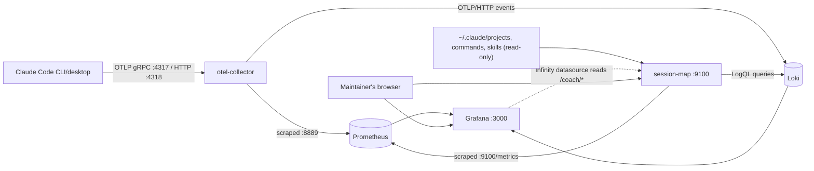

# Context and Scope

## Business Context

| Partner | Interaction |
| --- | --- |
| Claude Code (CLI and desktop app) | Emits OpenTelemetry metrics and log events over OTLP whenever `CLAUDE_CODE_ENABLE_TELEMETRY=1` is set; the stack never calls back into Claude Code. |
| `~/.claude/projects`, `~/.claude/commands`, `~/.claude/skills` on the host filesystem | Read-only source of conversation metadata, custom commands and skills; the stack never writes to them. |
| The maintainer (browser) | Views the Grafana dashboard, the session list/detail pages, and the improvement report; the only human-facing consumer. |
| An external AI chat (out of scope) | The improvement report is written to be pasted there; the stack has no integration with it — it only produces a file/page. |

## Technical Context

## Input and Output Channel Mapping

| Channel | Protocol / port | Direction | Payload |
| --- | --- | --- | --- |
| Claude Code → otel-collector | OTLP/gRPC `:4317`, OTLP/HTTP `:4318` | In | Metrics (tokens, cost, sessions, active time, lines of code, permission decisions) and log events (`api_request`, `tool_result`, `tool_decision`, `user_prompt`, `assistant_response`, `skill_activated`, …) |
| otel-collector → Prometheus | Scrape `:8889/metrics` | In (to Prometheus) | Six `claude_code_*` metrics, resource attributes converted to labels |
| otel-collector → Loki | OTLP/HTTP to `http://loki:3100/otlp` | In (to Loki) | The same log events, as structured metadata |
| Filesystem → session-map | Bind mounts, read-only | In | `~/.claude/projects/**/*.jsonl` (conversation metadata only), `~/.claude/commands/**/*.md`, `~/.claude/skills/**/SKILL.md` |
| session-map → Loki | LogQL `query_range` | Out (session-map is the client) | Request costs matched by request id; daily aggregates for history |
| Prometheus/session-map → Grafana | Scrape `:9100/metrics`; Grafana → Prometheus/Loki via `access: proxy` | In (to Grafana) | Metrics and events for dashboard panels |
| Grafana (Infinity datasource) → session-map | HTTP `http://session-map:9100/coach/*` | Out (from Grafana) | Improvement-report summary, findings, rules, tool-bytes tables for the "Mejoras" row |
| Browser → Grafana / session-map | HTTP `:3000`, `:9100` | In | Dashboard, `/sessions`, `/session/<id>`, `/report`, `/report.md`, `/report.json` |

All of the above ports are bound to `127.0.0.1` only (see [02](02-constraints.md)), so this context
diagram describes traffic on a single machine, not a network service.
