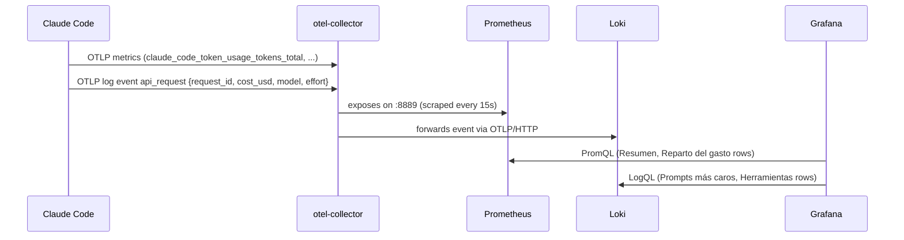
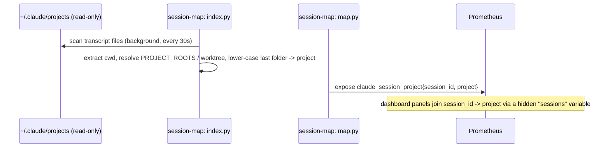
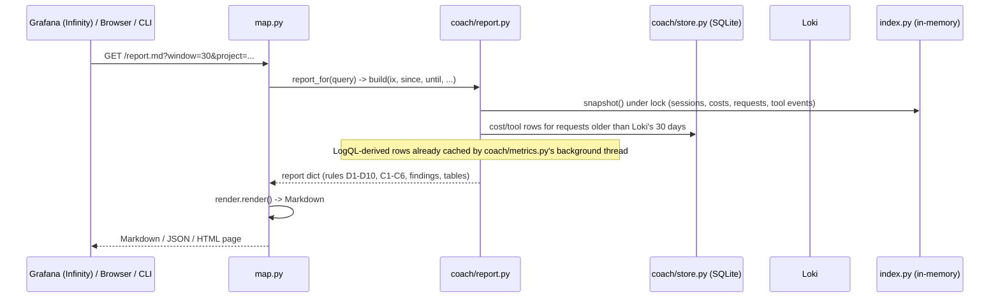

# Runtime View

## A Claude Code call turns into a dashboard number

### Notable Interactions

Metrics and events travel two independent paths from the same `otel-collector` receiver; Grafana reads
both, by design, because a metric (aggregated count) and an event (the individual `api_request` with
its full attributes, needed for example to show one expensive prompt) are different shapes of the same
underlying call.

### Failure Behavior

The collector's `debug` exporter runs alongside the real ones so `docker compose logs otel-collector`
shows what arrived even when Prometheus or Loki are unreachable. `metric_expiration: 24h` is set
explicitly (default 5 m) so metric series do not vanish from `:8889` minutes after a Claude Code session
closes.

## Project attribution for a session with no `OTEL_RESOURCE_ATTRIBUTES`

### Notable Interactions

This path exists entirely because the desktop app ignores `OTEL_RESOURCE_ATTRIBUTES` (see
[01](01-introduction-and-goals.md)). CLI sessions already carry a project label from telemetry, but the
dashboard treats both identically by always joining through `session-map`'s gauge, rather than branching
logic per client type.

### Failure Behavior

A new session has no project until its transcript file exists and Prometheus has scraped it (about 15
seconds). A session opened at a home folder or drive root, or with no recorded `cwd`, is reported as
`otros` rather than failing the join.

## Building the improvement report

### Notable Interactions

A report already built for the same range and projects is reused for two minutes (`report_for`'s
cache), so Grafana's "Mejoras" panels, the `/report` page and `/report.md` download all pay the
computation cost once per short window, not once per request.

### Failure Behavior

If a Loki query for a given day/kind fails, `coach/loki.py` records the error and leaves that kind for
the next round rather than failing the whole aggregate; `coach/metrics.py`'s loop catches exceptions per
round so a transient failure never stops the background thread. `coach/cli.py` takes the independent
path (reading transcripts itself) and is unaffected by the server's in-memory state.

## Report history surviving a restart

On every container start, `coach/metrics.py.start()` calls `Store.restore()` before the index begins
reading Loki again, repopulating `ix.costs`, `ix.requests` and `ix.tool_events` from SQLite so a
container recreate does not lose cost attribution for requests older than Loki's 30-day window. If the
`coach-data` volume is unavailable, `Store.__init__` falls back to an in-memory SQLite connection
(`self.persistent = False`) rather than failing startup — history is then lost on the next restart, but
the stack keeps running.
