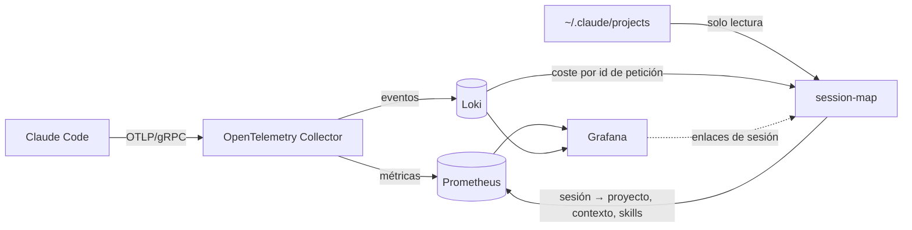

# Métricas de Claude Code

[English](README.md)

Pila de observabilidad local para [Claude Code](https://claude.com/claude-code). Claude Code exporta métricas y eventos OpenTelemetry; esta pila los guarda y dibuja un dashboard de Grafana que muestra cuántos tokens se consumen, cuánto cuestan, quién los usa y qué prompts, herramientas y skills generan el coste.

Todo corre con Docker Compose en una sola máquina.

## Arquitectura



| Servicio | Qué hace | Puerto | Persistencia |
| --- | --- | --- | --- |
| `otel-collector` | Recibe OTLP, expone las métricas para Prometheus y reenvía los eventos a Loki | 4317 (gRPC), 4318 (HTTP), 8889 (métricas) | ninguna |
| `prometheus` | Guarda las métricas y responde PromQL | 9090 | volumen `prometheus-data`, 90 días |
| `loki` | Guarda los eventos y responde LogQL | 3100 | volumen `loki-data`, 30 días |
| `session-map` | Publica a qué proyecto pertenece cada sesión y lo que muestran sus conversaciones, y sirve las páginas de sesión | 127.0.0.1:9100 | ninguna |
| `grafana` | Dashboards | 3000 | volumen `grafana-data` |

### Por qué existe `session-map`

La app de escritorio de Claude Code ignora `OTEL_RESOURCE_ATTRIBUTES`, así que sus sesiones llegan sin la etiqueta `project`. `session-map/map.py` lee los nombres de carpeta de `~/.claude/projects` (en solo lectura) y publica `claude_session_project{session_id, project}`. Los dos dashboards filtran por `session_id` mediante una variable oculta `sessions`, de modo que las sesiones de CLI y de escritorio, también las anteriores, se atribuyen a un proyecto.

El nombre del proyecto sale del directorio de trabajo que registró cada sesión (`cwd`), en minúsculas: su última carpeta, así que `C:\dev\billing-api` es `billing-api`. Los worktrees que crea Claude Code (`.claude/worktrees/…`) cuentan para el repositorio del que salen. Si guardas tus proyectos dentro de una o varias carpetas padre y a veces abres Claude Code en una subcarpeta, indica esas carpetas en `PROJECT_ROOTS` en `.env` (separadas por `;`, por ejemplo `PROJECT_ROOTS=C:\Workspace;D:\clientes`); una sesión en `C:\Workspace\billing-api\src` cuenta entonces para `billing-api`. Una sesión abierta en tu carpeta de usuario o en la raíz de una unidad, o sin `cwd` registrado, se publica como `otros`.

### Sesiones: el índice de conversaciones

`session-map` lee además los ficheros de conversación de Claude Code (`~/.claude/projects`, en solo lectura) en segundo plano y se queda solo con metadatos: fechas, modelos, tokens, nombres de herramientas, skills y comandos, compactaciones y el título de cada sesión. Nunca guarda el texto. Con ello la pila obtiene lo que la telemetría no da: todas las sesiones desde que se usa Claude Code, con el nombre real de sus skills y comandos (la telemetría oculta las skills propias como `custom_skill`), su título y cómo creció su contexto.

Los ficheros de conversación traen tokens pero no coste. El exportador lo toma de la telemetría de Loki, casando cada mensaje por su identificador de petición, así que un mensaje solo tiene coste si se hizo después de activar la telemetría. Se puede casar cerca de nueve décimas del coste que registra la telemetría; el resto son llamadas de fondo que nunca aparecen en una conversación.

En `http://localhost:9100` se sirven dos páginas: `/sessions`, la lista de sesiones, y `/session/<id>`, el detalle de una (ventana de contexto como barra, tamaño del contexto en cada mensaje con las compactaciones marcadas, coste acumulado, modelos, skills y comandos, herramientas con sus fallos, compactaciones y subagentes). Se abren desde el dashboard **Claude Code - Sesiones**, y desde la cifra **Sesiones con actividad** del dashboard de uso, y solo funcionan en la máquina que ejecuta la pila.

Claude Code no dice el tamaño de la ventana de contexto de un modelo, así que la barra de contexto supone 200k, o 1M cuando una sesión ya ha usado más de 200k. Indica el valor real por modelo en `.env`:

```
CONTEXT_LIMIT_DEFAULT=200000
CONTEXT_LIMITS=claude-opus-5-5=1000000
```

## Requisitos

- Docker con Docker Compose
- Claude Code con la telemetría activada (ver más abajo)
- `docker-compose.yml` asume rutas de Windows (`${USERPROFILE}`); en macOS o Linux, sustitúyelo por `${HOME}`

## Puesta en marcha

```bash
cp .env.example .env     # edita .env y define GRAFANA_ADMIN_PASSWORD
docker compose up -d
```

Abre Grafana en <http://localhost:3000> y entra como `admin` con la contraseña de `.env`. La contraseña solo se aplica la primera vez que Grafana arranca con el volumen `grafana-data` vacío; después, cámbiala desde el propio Grafana.

En Windows, `Iniciar-metricas.bat` inicia Docker Desktop si hace falta, ejecuta `docker compose up -d` y abre Grafana.

### El dashboard

Los datasources de Prometheus (uid `prometheus`), Loki (uid `loki`) y Coach (uid `coach`, Infinity, que lee el informe de mejoras de `session-map`) y el dashboard **Claude Code** se provisionan solos: no hay que importar nada. Grafana lee `Grafana/claude-code-dashboard.json` al arrancar, así que tras editarlo hay que ejecutar `docker compose restart grafana`. Como está provisionado, no se puede guardar desde la interfaz: los cambios se hacen en el JSON.

Si venías de una versión anterior en la que importabas los dashboards a mano, ejecuta `docker compose up -d`: el dashboard provisionado toma el relevo del importado (mismo uid `claude-code`) y el datasource Prometheus se recrea con su uid fijo. Los tres dashboards antiguos (Uso y coste, Eventos y Sesiones) siguen en tu Grafana hasta que los borres.

## Configurar Claude Code

Añade esto al bloque `env` de `~/.claude/settings.json`:

```json
{
  "env": {
    "CLAUDE_CODE_ENABLE_TELEMETRY": "1",
    "OTEL_METRICS_EXPORTER": "otlp",
    "OTEL_LOGS_EXPORTER": "otlp",
    "OTEL_EXPORTER_OTLP_PROTOCOL": "grpc",
    "OTEL_EXPORTER_OTLP_ENDPOINT": "http://localhost:4317",
    "OTEL_EXPORTER_OTLP_METRICS_TEMPORALITY_PREFERENCE": "cumulative",
    "OTEL_RESOURCE_ATTRIBUTES": "team=mi-equipo,department=mi-departamento"
  }
}
```

La configuración de telemetría se lee al arrancar la sesión, así que abre una sesión nueva tras cambiarla. Para etiquetar las sesiones de CLI con un proyecto, sobrescribe `OTEL_RESOURCE_ATTRIBUTES` en `<proyecto>/.claude/settings.local.json` y repite `team` y `department`, porque el valor del proyecto reemplaza al del usuario.

### Interruptores opcionales

| Variable | Efecto |
| --- | --- |
| `OTEL_LOG_USER_PROMPTS=1` | Envía el texto del prompt. Sin ella los prompts llegan como `<REDACTED>`. Solo afecta a sesiones nuevas. |
| `OTEL_LOG_TOOL_DETAILS=1` | Envía el nombre de las skills propias y de plugins en lugar de `custom_skill`. Desactivada por defecto. |

## Dashboards

Hay un único dashboard, **Claude Code**, organizado en cuatro filas. Tiene un selector **Proyecto** arriba a la izquierda, que filtra todos los paneles a las sesiones del proyecto elegido, y usa el selector de tiempo de Grafana, así que vale cualquier rango de fechas. La fila «Por hora» está plegada y carga sus consultas al abrirla. Hay tres tipos de panel que se repiten: un *stat* muestra un solo número, una *serie temporal* dibuja valores por hora o por intervalo y una *tabla con barras* ordena valores con una barra proporcional.

> «Mil» en el formato numérico en español de Grafana son millones («49,9 Mil» son 49,9 millones); «K» son miles.

Los paneles de sesiones y skills salen del índice de conversaciones, no de la telemetría, y cuentan los días en UTC. Las tablas de prompts más caros y de herramientas salen de Loki, que guarda 30 días: con un rango de 30 días justos Grafana puede dar error, así que usa 29 o menos. Del antiguo dashboard de Eventos se quitaron coste por origen, contexto por llamada y tokens por tipo, y el coste por usuario; bytes y duración por herramienta se unieron en la tabla «Herramientas».

### Resumen

| Panel | Tipo | Qué muestra | Qué aporta |
| --- | --- | --- | --- |
| Coste estimado | Stat | Gasto en dólares del periodo. | La cifra que más importa a presupuesto; se lee junto a los tokens para ver el precio medio. |
| Tokens | Stat | Todos los tokens del periodo (entrada, salida y caché), en millones. | El volumen global de un vistazo; sirve para comparar un día o un proyecto con otro. |
| USD por millón de tokens | Stat | El coste dividido entre los tokens. | El precio efectivo; baja con modelos más baratos o más caché. |
| Acierto de caché | Stat | Lectura de caché entre lectura, creación de caché y entrada. | Cuánto contexto se reutiliza en lugar de rehacerse. |
| Sesiones con actividad | Stat | Sesiones distintas que gastaron tokens dentro del periodo. | Distingue pocas sesiones muy caras de muchas baratas. Una sesión abierta sin uso no cuenta. Pulsa la cifra para ver la lista de sesiones. |
| Evolución diaria | Barras y línea | El coste de cada día (barras, eje izquierdo) y los tokens en millones (línea, eje derecho) del rango elegido. | La tendencia: días caros y si el coste y el volumen suben juntos. |
| Coste por effort | Barras | Qué parte del gasto corresponde a cada nivel de esfuerzo de razonamiento. | Muestra cuánto cuesta trabajar siempre en un nivel alto; es la palanca más directa para bajar el gasto. |
| Coste por proyecto | Barras | Coste del periodo por proyecto, con el mapa de sesiones. | Atribuye el gasto a proyectos. |

### Reparto del gasto

| Panel | Tipo | Qué muestra | Qué aporta |
| --- | --- | --- | --- |
| Cuota de coste y de tokens por modelo | Barras agrupadas | Para los diez modelos con más coste, su parte del coste total y de los tokens totales; `Otros` suma el resto. | Una barra de tokens mucho más larga que la de coste es un modelo barato; al revés, caro. Sustituye al antiguo gráfico circular de coste por modelo. |
| Detalle por modelo y effort | Tabla | Coste del periodo para cada combinación de effort y modelo, con el total en el pie. | La cifra exacta detrás de los gráficos, para copiarla a un informe. |

### Sesiones, skills y prompts

| Panel | Tipo | Qué muestra | Qué aporta |
| --- | --- | --- | --- |
| Contexto de las sesiones | Tabla con barras | Para las sesiones con actividad dentro del periodo elegido (hasta las 30 más recientes, `CONTEXT_SESSIONS`), el porcentaje de la ventana de contexto en uso (barra, verde por debajo del 60 %, naranja hasta el 85 %, roja por encima), los tokens usados, los libres y el límite; pulsa una sesión para abrir su detalle. | Muestra lo cerca que está una sesión de su límite y de necesitar compactarse. |
| Uso de skills y comandos (veces) | Tabla con barras | Cada comando propio ejecutado y cada skill cargada en el periodo, con su nombre real, cuántas veces como comando (escrito por ti) y como skill (cargada por Claude). | Muestra qué skills y comandos se usan de verdad, también las que Claude carga solo. El coste de cada comando está en «Modelos y origen por comando». |
| Modelos y origen por comando | Tabla anidada | Una fila por comando con su coste total; al desplegarla, el coste de los turnos que lanzó separado por modelo y por origen: `sdk` es el hilo principal, `agent:...` son subagentes y `prompt_suggestion`, `compact` o `web_search_tool` son llamadas de fondo. | Responde a «qué modelos se usaron al lanzar este comando». Solo cuenta el turno del comando, no las respuestas posteriores. |
| Prompts más caros | Tabla | Cada prompt con su coste y su texto. Pulsar el identificador abre su línea de tiempo en Explore. Excluye los prompts redactados. | Pasa de «este prompt costó mucho» a «este fue el prompt». El texto solo existe en sesiones nuevas con `OTEL_LOG_USER_PROMPTS=1`. |
| Herramientas | Tabla con barras | Por herramienta: cuántas veces se llamó, cuántos bytes devolvió, esos bytes como tokens aproximados (bytes entre 4, en miles) y cuánto tardó de media. Los tokens son una estimación, no una medida, y no hay columna de coste porque la telemetría no lo relaciona con la herramienta. | Encuentra las herramientas que llenan el contexto (lo devuelto se relee en las llamadas siguientes) o que hacen esperar, y sirve para decidir qué recortar o desactivar. |

### Por hora

| Panel | Tipo | Qué muestra | Qué aporta |
| --- | --- | --- | --- |
| Tokens por modelo (por hora) | Barras por hora | Tokens de cada hora, separados por modelo, en millones. | Localiza las horas de más actividad y detecta si empieza a usarse un modelo nuevo. |
| Coste por modelo y effort (por hora) | Barras por hora | Coste de cada hora separado por modelo y nivel de esfuerzo. | Muestra qué horas fueron caras y con qué esfuerzo; une el reparto del coste con el reloj. |

## Informe de mejoras

`session-map` analiza tu uso y genera un informe en Markdown pensado para pegarlo en una IA y pedirle qué cambiar. Lleva unas instrucciones para la IA, un resumen comparado con el periodo anterior, los **hallazgos** de unas reglas automáticas y las tablas en las que se basan. No contiene texto de conversaciones, de prompts ni de errores, ni correos de usuario.

Las reglas son las mismas que las del módulo de OpenCode, con los mismos identificadores, más seis propias de Claude Code:

| Regla | Qué busca |
| --- | --- |
| D1 Errores de herramienta | Errores evitables repetidos por herramienta y clase (rutas inexistentes, `old_string` no encontrado, errores de PowerShell…) |
| D2 Coste por modelo u origen | Un modelo o los subagentes concentran el coste |
| D3 Bucles y exploración | Llamadas repetidas con los mismos argumentos, rachas de errores, turnos muy largos |
| D4 Contexto | Sesiones con varias compactaciones |
| D5 Permisos | Llamadas rechazadas o bloqueadas por herramienta |
| D6 Caché | Modelos con poca caché |
| D7 Skills | Skills instaladas que no se usan |
| D8 Modelo fijado en comandos | Comandos cuyo `model:` falla mucho con alguna herramienta |
| D9 Interrupciones | Respuestas interrumpidas y vueltas a pedir enseguida |
| D10 Comandos | Comandos sin uso o duplicados (`ai-1-spec` y `1-spec`) |
| C1 Effort | La mayor parte del coste con *effort* alto |
| C2 Consumo de fondo | Peso de las llamadas de fondo (`prompt_suggestion`, `compact`…) |
| C3 Resultados grandes | Herramientas que devuelven mucho texto al contexto |
| C4 Planes rechazados | Muchos planes de `ExitPlanMode` rechazados |
| C5 Peticiones de permiso | Herramientas que apruebas a mano una y otra vez (con la regla `allow` propuesta) |
| C6 Contexto inicial | Sesiones que empiezan con mucho contexto (CLAUDE.md, herramientas MCP) |

Tres formas de obtenerlo, con el mismo contenido:

- **Grafana:** el enlace **Informe de mejoras**, arriba a la derecha, y las cifras de la fila «Mejoras» lo abren en una pestaña nueva (`/report`) con el rango y los proyectos elegidos. Esa página muestra el informe, enlaza cada sesión de ejemplo con su detalle y tiene un botón **Descargar informe (.md)**, otro para copiar el Markdown y otro para ocultar los nombres de proyecto.
- **Navegador:** `http://localhost:9100/report?window=30` lo muestra como página y `http://localhost:9100/report.md?window=30` lo descarga (`window` en días, o `from` y `to` en tiempo Unix), con `project` y `anon=1` para ocultar los nombres de proyecto. `/report.json` devuelve lo mismo en JSON, con el mismo formato que el informe de OpenCode.
- **Consola:** `docker compose exec session-map python /app/coach/cli.py report --window 30 > informe.md`.

**De dónde sale.** De las conversaciones (cada llamada a herramienta con su resultado, el turno, interrupciones y rechazos; el texto de un error se lee para clasificarlo y se descarta), de los eventos de Loki (*effort*, origen de cada petición, bytes devueltos por herramienta, decisiones de permisos) y de `~/.claude/commands` y `~/.claude/skills`, montadas en solo lectura.

**Historial.** Loki guarda 30 días y `session-map` perdía al reiniciarse el coste de las sesiones antiguas. Ahora un SQLite pequeño en el volumen `coach-data` guarda cada petición (coste, modelo, origen, effort y sesión) y cada evento de herramienta (herramienta, sesión, bytes devueltos y decisión de permiso, nunca sus parámetros), así que el historial crece desde el día en que se activa. La sección 6 del informe (effort, origen de las llamadas, tamaño de lo que devuelven las herramientas y decisiones de permiso) sale de esas filas, con el mismo periodo y filtro de proyecto que el resto del informe.

**Fila «Mejoras» del dashboard.** Sigue el selector de tiempo y el de proyecto. Las mejoras detectadas, su impacto, la tabla de hallazgos (regla, severidad, impacto, evidencia y recomendación), los hallazgos por regla y los bytes que cada herramienta devuelve al contexto se leen de `session-map` (`/coach/summary`, `/coach/findings`, `/coach/rules`, `/coach/tool_bytes`) con el datasource Infinity, así que son el mismo cálculo que el informe que se descarga; un informe ya calculado para el mismo rango y proyectos se reutiliza durante dos minutos. Los errores evitables, las compactaciones e interrupciones, los errores por herramienta y modelo y las tendencias semanales salen de Prometheus. Grafana instala el plugin Infinity al arrancar (`GF_PLUGINS_PREINSTALL_SYNC`), así que el primer arranque tras este cambio necesita acceso a internet.

## Datos disponibles

### Métricas (Prometheus)

Llegan seis métricas a Prometheus. Se pueden desglosar por proyecto, modelo, esfuerzo, usuario, equipo y sesión.

| Métrica | Qué mide | Etiquetas propias |
| --- | --- | --- |
| `claude_code_token_usage_tokens_total` | Tokens consumidos | `type` (entrada, salida, caché), `model`, `effort`, `query_source` |
| `claude_code_cost_usage_USD_total` | Coste estimado en USD | `model`, `effort`, `query_source` |
| `claude_code_session_count_total` | Sesiones de CLI iniciadas | `start_type` |
| `claude_code_active_time_seconds_total` | Tiempo activo de uso, en segundos | `type` |
| `claude_code_lines_of_code_count_total` | Líneas de código añadidas o eliminadas | `type` (añadidas o eliminadas), `model` |
| `claude_code_code_edit_tool_decision_total` | Decisiones de permiso (aceptar o rechazar) sobre las herramientas Edit, Write y NotebookEdit | `decision`, `tool_name`, `language`, `source` |

Etiquetas por las que se puede desglosar:

- **Uso:** `model`, `effort`, `type` y `query_source` (distingue el agente principal de los subagentes).
- **Quién y dónde:** `user_email`, `user_id`, `user_account_uuid`, `organization_id`, además de `team`, `department` y `project`, que defines tú.
- **Contexto:** `session_id`, `terminal_type`, `os_type`, `os_version`, `host_arch`, `service_version`, y atributos de la cuenta como `anthropic_plan`, `anthropic_seat_type` y `claude_deployment_mode`.

### Métricas de sesión (session-map)

| Métrica | Tipo | Etiquetas | Significado |
| --- | --- | --- | --- |
| `claude_session_project` | gauge | `session_id`, `project` | A qué proyecto pertenece cada sesión |
| `claude_context_tokens` | gauge | `session`, `label`, `project`, `model`, `type` (`input`, `cache_read`, `cache_write`, `output`) | Tokens del último mensaje del hilo principal de cada una de las 30 sesiones más recientes (`CONTEXT_SESSIONS`) |
| `claude_context_limit_tokens` | gauge | como `claude_context_tokens`, sin `type` | El límite de contexto supuesto |
| `claude_day_sessions` | gauge | `day`, `project` | Sesiones creadas cada día UTC |
| `claude_day_skill_uses` | gauge | `day`, `skill`, `project`, `kind` (`command` o `skill`) | Veces que se ejecutó cada comando o se cargó cada skill |
| `claude_day_skill_cost_usd` | gauge | `day`, `skill`, `project` | Coste de los mensajes que Claude Code atribuye a cada skill o comando, donde la telemetría lo conoce |
| `claude_day_command_cost_usd` | gauge | `day`, `command`, `project`, `model`, `origin` | Coste de los turnos que lanzó cada comando (comparten su `prompt_id`), por modelo y origen (`query_source`) |
| `claude_day_start_seconds` | gauge | `day` | Inicio de cada día UTC como tiempo Unix, para filtrar días |
| `claude_index_scan_complete`, `claude_index_cost_requests` | gauge | ninguna | Si el índice ya leyó todos los ficheros, y cuántos costes de petición tiene |

### Eventos (Loki)

Cada llamada al modelo y cada herramienta generan un evento. Todos comparten `prompt_id`, que agrupa lo que pasa dentro de un mismo prompt del usuario. Los atributos de cada evento quedan como metadatos estructurados.

| Evento | Atributos útiles |
| --- | --- |
| `api_request` | `model`, `effort`, `query_source`, `input_tokens`, `output_tokens`, `cache_read_tokens`, `cache_creation_tokens`, `cost_usd`, `duration_ms`, `ttft_ms` |
| `tool_result` | `tool_name`, `duration_ms`, `success`, `tool_input_size_bytes`, `tool_result_size_bytes` |
| `tool_decision` | `tool_name`, `decision`, `source` |
| `user_prompt` | `prompt_length`; el texto solo con `OTEL_LOG_USER_PROMPTS=1` |
| `assistant_response` | `response_length` |
| `skill_activated` | `skill_name`, `skill_source`; las skills propias y de plugins salen como `custom_skill` salvo con `OTEL_LOG_TOOL_DETAILS=1` |
| `hook_execution_*`, `plugin_loaded`, `mcp_server_connection`, `at_mention` | Arranque de hooks, plugins y servidores MCP, y menciones de ficheros |

Para seguir un prompt caro, abre Explore en Grafana con `{service_name=~".+"} | prompt_id="<id>"`.

## Operación

```bash
docker compose up -d                                       # arrancar
docker compose up -d --force-recreate otel-collector       # aplicar cambios del collector
docker compose logs --tail 50 otel-collector               # ver qué llega
curl -s http://localhost:8889/metrics | grep claude_code   # comprobar las métricas expuestas
```

La limpieza es continua: Loki marca lo que supera 30 días cada 10 minutos y lo borra dos horas después; Prometheus borra por bloques, así que puede conservar hasta unos nueve días más.

## Limitaciones

- El coste es una estimación que calcula el cliente a partir de los tokens, no una factura.
- El coste por skill no se puede aislar, porque LogQL no cruza eventos. La tabla de skills suma el coste de los prompts que activan cada skill, incluido el resto del turno.
- Una sesión nueva no tiene proyecto hasta que Claude Code crea su fichero de conversación y Prometheus lo recoge (unos 15 segundos). Si Claude Code borra transcripts antiguos, esas sesiones pierden el proyecto.
- Los paneles de sesiones y skills del dashboard y las páginas de sesión salen de los ficheros de conversación, así que cubren todas las sesiones que Claude Code ha conservado, pero una sesión solo tiene coste por las llamadas hechas desde que se activó la telemetría. «—» significa desconocido, no cero.
- Los mensajes de un subagente cuentan en los tokens y el coste de su sesión, y no forman parte de la barra de contexto, que sigue el hilo principal.
- Los ficheros de conversación se leen una vez en segundo plano al arrancar la pila (medio minuto para 300 MB) y después solo lo que se añade.
- Loki solo guarda los eventos desde que se puso en marcha la pila.
- No hay alta disponibilidad ni copias de seguridad de los volúmenes.

## Seguridad y privacidad

- La pila está pensada para una sola máquina de confianza. Los puertos se publican solo en `127.0.0.1`, porque el collector, Loki y Prometheus no tienen autenticación y Loki guarda los atributos de la telemetría (entre ellos el correo y el identificador de la cuenta). Para recibir telemetría de otras máquinas, publica el collector en todas las interfaces a propósito y solo en una red de confianza.
- La contraseña de Grafana sale de `.env`, que git ignora.
- Las páginas de sesión se sirven en `127.0.0.1:9100` sin autenticación. Muestran los títulos de sesión, que Claude Code deriva de las conversaciones, los costes y los nombres de herramientas, skills y comandos, nunca el texto de la conversación. El exportador lee los ficheros de conversación, que sí contienen el texto completo, pero se queda solo con metadatos.
- Las métricas y los eventos incluyen el correo y los identificadores del usuario.
- Con `OTEL_LOG_USER_PROMPTS=1`, el texto de los prompts se guarda en Loki durante 30 días. Desactívala si la pila deja de ser local.
- El informe de mejoras (`/report.md`) contiene cifras, nombres de modelos, herramientas, skills, comandos y proyectos, e identificadores de sesión; nunca texto de conversaciones, prompts o errores, ni correos. `anon=1` oculta los nombres de proyecto. `session-map` monta además `~/.claude/commands` y `~/.claude/skills` en solo lectura; nunca `~/.claude` entero ni `settings.json`.

## Estructura del repositorio

```
docker-compose.yml            servicios, puertos y volúmenes
.env.example                  variables para copiar a .env
otel-collector-config.yaml    receptor OTLP y exportadores
prometheus.yml                scrape del collector y de session-map
loki-config.yaml              almacenamiento y retención de 30 días
grafana-datasource.yaml       datasources provisionados
grafana-dashboards.yaml       proveedor de dashboards provisionados
session-map/map.py            exportador y páginas de sesión
session-map/index.py          índice de conversaciones y búsqueda de costes
session-map/pages.py          HTML de las páginas de sesión
session-map/report_page.py    página HTML del informe de mejoras, con el botón de descarga
session-map/coach/            informe de mejoras: reglas, almacén, Loki, Markdown, métricas y consola
Grafana/                      dashboard provisionado
Iniciar-metricas.bat          lanzador para Windows
```

## Licencia

[MIT](LICENSE): puedes usar, modificar y redistribuir el código, también con fines comerciales, siempre que conserves el aviso de copyright y la licencia.
