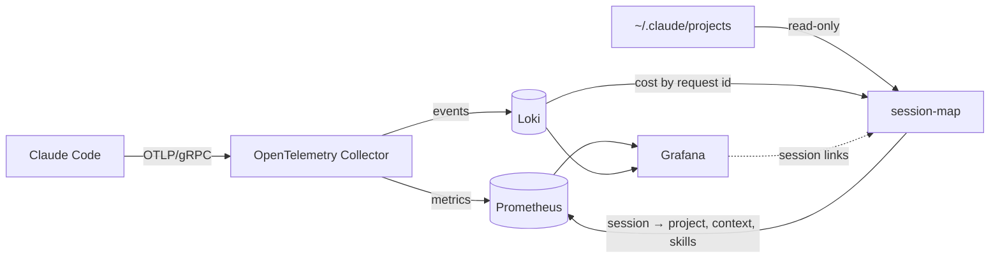

# Claude Code metrics

[Español](README.es.md)

A local observability stack for [Claude Code](https://claude.com/claude-code). Claude Code exports OpenTelemetry metrics and events; this stack stores them and draws a Grafana dashboard that shows how many tokens are consumed, how much they cost, who uses them and which prompts, tools and skills drive the cost.

Everything runs with Docker Compose on one machine.

## Architecture



| Service | Role | Port | Storage |
| --- | --- | --- | --- |
| `otel-collector` | Receives OTLP, exposes metrics for Prometheus, forwards events to Loki | 4317 (gRPC), 4318 (HTTP), 8889 (metrics) | none |
| `prometheus` | Stores metrics and answers PromQL | 9090 | volume `prometheus-data`, 90 days |
| `loki` | Stores events and answers LogQL | 3100 | volume `loki-data`, 30 days |
| `session-map` | Publishes which project each session belongs to and what its conversations show, and serves the session pages | 127.0.0.1:9100 | none |
| `grafana` | Dashboards | 3000 | volume `grafana-data` |

### Why `session-map`

The Claude Code desktop app ignores `OTEL_RESOURCE_ATTRIBUTES`, so its sessions arrive without a `project` label. `session-map/map.py` reads the folder names under `~/.claude/projects` (read-only) and publishes `claude_session_project{session_id, project}`. Both dashboards filter by `session_id` through a hidden `sessions` variable, so CLI and desktop sessions, including past ones, are attributed to a project.

The project name comes from the working directory each session recorded (`cwd`), in lower case: its last folder, so `C:\dev\billing-api` is `billing-api`. Worktrees created by Claude Code (`.claude/worktrees/…`) count for the repository they come from. If you keep your projects under one or more parent folders and sometimes start Claude Code in a subfolder, list those parents in `PROJECT_ROOTS` in `.env` (separated by `;`, for example `PROJECT_ROOTS=C:\Workspace;D:\clients`); a session in `C:\Workspace\billing-api\src` then counts for `billing-api`. A session opened in your home folder or at a drive root, or with no recorded `cwd`, is reported as `otros`.

### Sessions: the conversation index

`session-map` also reads Claude Code's conversation files (`~/.claude/projects`, read-only) in the background and keeps only metadata: timestamps, models, token counts, the names of tools, skills and commands, compactions and the title of each session. It never keeps the text. From it the stack gets what the telemetry does not give: every session since Claude Code was first used, with its real skill and command names (the telemetry hides custom skills as `custom_skill`), its title and how its context grew.

The conversation files carry tokens but no cost. The exporter takes the cost from the telemetry in Loki, matching each message by its request id, so a message has a cost only if it was made after the telemetry was switched on. About nine tenths of the cost the telemetry records can be matched; the rest belongs to background calls that never appear in a conversation.

Two pages are served on `http://localhost:9100`: `/sessions`, the list of sessions, and `/session/<id>`, the detail of one (context window as a bar, context size at every message with the compactions marked, accumulated cost, models, skills and commands, tools with their failures, compactions and subagents). They are opened from the **Claude Code - Sesiones** dashboard, and from the **Sesiones con actividad** figure of the usage dashboard, and only work on the machine that runs the stack.

Claude Code does not tell the size of the context window of a model, so the context bar assumes 200k, or 1M when a session has already used more than 200k. Set the real value per model in `.env`:

```
CONTEXT_LIMIT_DEFAULT=200000
CONTEXT_LIMITS=claude-opus-5-5=1000000
```

## Requirements

- Docker with Docker Compose
- Claude Code with telemetry enabled (see below)
- Windows paths are assumed in `docker-compose.yml` (`${USERPROFILE}`); on macOS or Linux, replace it with `${HOME}`

## Quick start

```bash
cp .env.example .env     # then edit .env and set GRAFANA_ADMIN_PASSWORD
docker compose up -d
```

Open Grafana at <http://localhost:3000> and sign in as `admin` with the password from `.env`. The password only applies the first time Grafana starts with an empty `grafana-data` volume; after that, change it in Grafana itself.

On Windows, `Iniciar-metricas.bat` starts Docker Desktop if needed, runs `docker compose up -d` and opens Grafana.

### The dashboard

The Prometheus (uid `prometheus`) and Loki (uid `loki`) datasources and the **Claude Code** dashboard are provisioned automatically: there is nothing to import. Grafana reads `Grafana/claude-code-dashboard.json` when it starts, so after editing it run `docker compose restart grafana`. Because it is provisioned it cannot be saved from the interface: changes are made in the JSON.

If you come from an earlier version where you imported the dashboards by hand, run `docker compose up -d`: the provisioned dashboard takes over from the imported one (same uid `claude-code`) and the Prometheus datasource is recreated with its fixed uid. The three old dashboards (Uso y coste, Eventos and Sesiones) stay in your Grafana until you delete them.

## Configure Claude Code

Add this to the `env` block of `~/.claude/settings.json`:

```json
{
  "env": {
    "CLAUDE_CODE_ENABLE_TELEMETRY": "1",
    "OTEL_METRICS_EXPORTER": "otlp",
    "OTEL_LOGS_EXPORTER": "otlp",
    "OTEL_EXPORTER_OTLP_PROTOCOL": "grpc",
    "OTEL_EXPORTER_OTLP_ENDPOINT": "http://localhost:4317",
    "OTEL_EXPORTER_OTLP_METRICS_TEMPORALITY_PREFERENCE": "cumulative",
    "OTEL_RESOURCE_ATTRIBUTES": "team=my-team,department=my-department"
  }
}
```

Telemetry settings are read when a session starts, so open a new session after changing them. To label CLI sessions with a project, override `OTEL_RESOURCE_ATTRIBUTES` in `<project>/.claude/settings.local.json` and repeat `team` and `department`, because the project value replaces the user one.

### Optional switches

| Variable | Effect |
| --- | --- |
| `OTEL_LOG_USER_PROMPTS=1` | Sends the prompt text. Without it prompts arrive as `<REDACTED>`. Only affects new sessions. |
| `OTEL_LOG_TOOL_DETAILS=1` | Sends custom and plugin skill names instead of `custom_skill`. Off by default. |

## Dashboards

There is a single dashboard, **Claude Code**, organised in four rows. It has a **Proyecto** selector at the top left, which filters every panel to the sessions of the chosen project, and it uses Grafana's time picker, so any date range works. The "Por hora" row is collapsed and loads its queries when opened. Three panel types appear throughout: a *stat* shows one number, a *time series* plots values per hour or per interval and a *table with bars* sorts values with a proportional bar.

> «Mil» in Grafana's Spanish number format means millions («49,9 Mil» is 49.9 million); «K» means thousands.

The session and skill panels come from the conversation index, not from the telemetry, and count days in UTC. The most-expensive-prompts and tools tables come from Loki, which keeps 30 days: with exactly a 30-day range Grafana may show an error, so use 29 or fewer. Cost per origin, context per call, tokens per type and the cost per user were dropped from the former Events dashboard; bytes and duration per tool were merged into the "Herramientas" table.

### Resumen

| Panel | Type | What it shows | What it is for |
| --- | --- | --- | --- |
| Coste estimado | Stat | Spend in dollars for the period. | The figure that matters for budgeting; read it next to the tokens to see the average price. |
| Tokens | Stat | All tokens in the period (input, output and cache), in millions. | Overall volume at a glance; compare one day or project with another. |
| USD por millón de tokens | Stat | The cost divided by the tokens. | The effective price; it drops with cheaper models or more cache. |
| Acierto de caché | Stat | Cache reads over cache reads, cache creation and input. | How much context is reused instead of rebuilt. |
| Sesiones con actividad | Stat | Distinct sessions that consumed tokens in the period. | Tells a few expensive sessions from many cheap ones. An open session with no use does not count. Click the figure for the list of sessions. |
| Evolución diaria | Bars and line | The cost of each day (bars, left axis) and the tokens in millions (line, right axis) over the chosen range. | The trend: expensive days and whether cost and volume rise together. |
| Coste por effort | Bars | Share of the spend per reasoning effort level. | Shows what always working at a high level costs; it is the most direct lever to lower spend. |
| Coste por proyecto | Bars | Cost of the period per project, using the session map. | Attributes spend to projects. |

### Reparto del gasto

| Panel | Type | What it shows | What it is for |
| --- | --- | --- | --- |
| Cuota de coste y de tokens por modelo | Grouped bars | For the ten models with the highest cost, their share of the total cost and of the total tokens; `Otros` adds up the rest. | A token bar much longer than the cost bar is a cheap model; the other way round, an expensive one. Replaces the former cost-by-model pie chart. |
| Detalle por modelo y effort | Table | Cost of the period for each effort and model pair, with the total in the footer. | The exact figures behind the charts, ready to copy into a report. |

### Sesiones, skills y prompts

| Panel | Type | What it shows | What it is for |
| --- | --- | --- | --- |
| Contexto de las sesiones | Table with bars | For the sessions with activity inside the selected period (up to the 30 most recent, `CONTEXT_SESSIONS`), the percentage of the context window in use (bar, green below 60 %, orange up to 85 %, red above), the tokens used, the free ones and the limit; click a session to open its detail. | Shows how close a session is to its limit and to needing compaction. |
| Uso de skills y comandos (veces) | Table with bars | Each custom command run and each skill loaded in the period, with its real name, how many times as a command (typed by you) and as a skill (loaded by Claude). | Shows which skills and commands are really used, including the ones Claude loads on its own. The cost of each command is in "Modelos y origen por comando". |
| Modelos y origen por comando | Nested table | One row per command with its total cost; expand it to see the cost of the turns it launched split by model and by origin: `sdk` is the main thread, `agent:...` are subagents and `prompt_suggestion`, `compact` or `web_search_tool` are background calls. | Answers "which models were used when I ran this command". It counts only the command's own turn, not later replies. |
| Prompts más caros | Table | Each prompt with its cost and its text. Clicking the identifier opens its timeline in Explore. Redacted prompts are excluded. | Goes from "this prompt cost a lot" to "this was the prompt". The text exists only in new sessions with `OTEL_LOG_USER_PROMPTS=1`. |
| Herramientas | Table with bars | Per tool: how many times it was called, how many bytes it returned, those bytes as approximate tokens (bytes divided by 4, in thousands) and how long it took on average. The tokens are an estimate, not a measurement, and there is no cost column because the telemetry does not tie cost to a tool. | Finds the tools that fill the context (what they return is re-read in later calls) or make you wait, and helps decide what to trim or disable. |

### Por hora

| Panel | Type | What it shows | What it is for |
| --- | --- | --- | --- |
| Tokens por modelo (por hora) | Hourly bars | Tokens per hour, split by model, in millions. | Locates the busiest hours and spots when a new model starts being used. |
| Coste por modelo y effort (por hora) | Hourly bars | Cost per hour, split by model and effort. | Shows which hours were expensive and at which effort; links the cost split with the clock. |

## Improvement report

`session-map` analyses your usage and builds a Markdown report meant to be pasted into an AI to ask what to change. It holds instructions for the AI, a summary compared with the previous period, the **findings** of a set of automatic rules and the tables behind them. It holds no text of conversations, prompts or errors, and no user e-mails. The report is written in Spanish.

The rules are the same as in the OpenCode module, with the same ids (D1 tool errors, D2 cost by model or origin, D3 loops and long exploration, D4 context, D5 permissions, D6 cache, D7 unused skills, D8 pinned model in commands, D9 interruptions, D10 unused or duplicate commands), plus six for Claude Code only: C1 high *effort*, C2 background calls, C3 tools that return large results to the context, C4 rejected plans, C5 permissions you keep approving by hand (with the `allow` rule to add) and C6 sessions that start with a large context.

Three ways to get it, with the same content:

- **Grafana:** the **Informe de mejoras (.md)** link, at the top right, for the selected range and projects.
- **Browser:** `http://localhost:9100/report.md?window=30` (`window` in days, or `from` and `to` as Unix time), with `project` and `anon=1` to hide project names. `/report.json` returns the same as JSON, in the same format as the OpenCode report.
- **Command line:** `docker compose exec session-map python /app/coach/cli.py report --window 30 > report.md`.

**Sources.** The conversation files (each tool call with its result, the turn, interruptions and rejections; an error's text is read to classify it and then discarded), Loki's events (*effort*, origin of each request, bytes returned by each tool, permission decisions) and `~/.claude/commands` and `~/.claude/skills`, mounted read-only.

**History.** Loki keeps 30 days and `session-map` lost the cost of old sessions on restart. A small SQLite in the `coach-data` volume now keeps the cost of each request and Loki's daily aggregates, so history grows from the day it is enabled.

**The dashboard's «Mejoras» row.** Findings and impact (last 30 days; clicking opens the report), avoidable errors, compactions and interruptions, findings per rule, errors per tool and model, the weekly cost per message of each model and weekly errors per tool, and the bytes each tool returns to the context. Everything is computed in the background; a scrape only copies the cached result.

## Available data

### Metrics (Prometheus)

Six metrics reach Prometheus. They can be broken down by project, model, effort, user, team and session.

| Metric | What it measures | Own labels |
| --- | --- | --- |
| `claude_code_token_usage_tokens_total` | Tokens consumed | `type` (input, output, cache), `model`, `effort`, `query_source` |
| `claude_code_cost_usage_USD_total` | Estimated cost in USD | `model`, `effort`, `query_source` |
| `claude_code_session_count_total` | CLI sessions started | `start_type` |
| `claude_code_active_time_seconds_total` | Active usage time, in seconds | `type` |
| `claude_code_lines_of_code_count_total` | Lines of code added or removed | `type` (added or removed), `model` |
| `claude_code_code_edit_tool_decision_total` | Permission decisions (accept or reject) on the Edit, Write and NotebookEdit tools | `decision`, `tool_name`, `language`, `source` |

Labels available for breakdowns:

- **Usage:** `model`, `effort`, `type` and `query_source` (separates the main agent from subagents).
- **Who and where:** `user_email`, `user_id`, `user_account_uuid`, `organization_id`, plus `team`, `department` and `project`, which you set yourself.
- **Context:** `session_id`, `terminal_type`, `os_type`, `os_version`, `host_arch`, `service_version`, and account attributes such as `anthropic_plan`, `anthropic_seat_type` and `claude_deployment_mode`.

### Session metrics (session-map)

| Metric | Type | Labels | Meaning |
| --- | --- | --- | --- |
| `claude_session_project` | gauge | `session_id`, `project` | Which project each session belongs to |
| `claude_context_tokens` | gauge | `session`, `label`, `project`, `model`, `type` (`input`, `cache_read`, `cache_write`, `output`) | Tokens of the last message of the main thread of each of the 30 most recent sessions (`CONTEXT_SESSIONS`) |
| `claude_context_limit_tokens` | gauge | as `claude_context_tokens`, without `type` | The context limit assumed for it |
| `claude_day_sessions` | gauge | `day`, `project` | Sessions created each UTC day |
| `claude_day_skill_uses` | gauge | `day`, `skill`, `project`, `kind` (`command` or `skill`) | Times each command was run or skill was loaded |
| `claude_day_skill_cost_usd` | gauge | `day`, `skill`, `project` | Cost of the messages Claude Code attributes to each skill or command, where the telemetry knows it |
| `claude_day_command_cost_usd` | gauge | `day`, `command`, `project`, `model`, `origin` | Cost of the turns each command launched (they share its `prompt_id`), by model and origin (`query_source`) |
| `claude_day_start_seconds` | gauge | `day` | Start of each UTC day as a Unix time, used to filter days |
| `claude_index_scan_complete`, `claude_index_cost_requests` | gauge | none | Whether the index has read every file, and how many request costs it holds |

### Events (Loki)

Every model call and every tool run produces an event. All of them share `prompt_id`, which groups what happens inside one user prompt. Event attributes are stored as structured metadata.

| Event | Useful attributes |
| --- | --- |
| `api_request` | `model`, `effort`, `query_source`, `input_tokens`, `output_tokens`, `cache_read_tokens`, `cache_creation_tokens`, `cost_usd`, `duration_ms`, `ttft_ms` |
| `tool_result` | `tool_name`, `duration_ms`, `success`, `tool_input_size_bytes`, `tool_result_size_bytes` |
| `tool_decision` | `tool_name`, `decision`, `source` |
| `user_prompt` | `prompt_length`; the text only with `OTEL_LOG_USER_PROMPTS=1` |
| `assistant_response` | `response_length` |
| `skill_activated` | `skill_name`, `skill_source`; custom and plugin skills show as `custom_skill` unless `OTEL_LOG_TOOL_DETAILS=1` |
| `hook_execution_*`, `plugin_loaded`, `mcp_server_connection`, `at_mention` | Start-up of hooks, plugins and MCP servers, and file mentions |

To follow one expensive prompt, open Explore in Grafana with `{service_name=~".+"} | prompt_id="<id>"`.

## Operation

```bash
docker compose up -d                                       # start
docker compose up -d --force-recreate otel-collector       # apply collector config changes
docker compose logs --tail 50 otel-collector               # see what arrives
curl -s http://localhost:8889/metrics | grep claude_code   # check exposed metrics
```

Retention is continuous: Loki marks data older than 30 days every 10 minutes and deletes it two hours later; Prometheus deletes by block, so it can keep up to about nine extra days.

## Limitations

- Cost is an estimate computed by the client from token counts, not an invoice.
- Cost per skill cannot be isolated, because LogQL does not join events. The skill table adds up the cost of the prompts that activate each skill, including the rest of the turn.
- A new session has no project until Claude Code creates its transcript file and Prometheus scrapes it (about 15 seconds). If Claude Code deletes old transcripts, those sessions lose their project.
- The session and skill panels of the dashboard and the session pages come from conversation files, so they cover every session Claude Code has kept, but a session has a cost only for the calls made since the telemetry was switched on. «—» means unknown, not zero.
- A subagent's messages count in the tokens and cost of its session, and are not part of the context bar, which follows the main thread.
- The conversation files are read once in the background after the stack starts (about half a minute for 300 MB) and then only what is appended.
- Loki only holds events from when the stack was started.
- No high availability and no backups of the volumes.

## Security and privacy

- The stack is meant for a single trusted machine. Ports are published on `127.0.0.1` only, because the collector, Loki and Prometheus have no authentication and Loki keeps the telemetry attributes (user email and account id among them). To receive telemetry from other machines, publish the collector on all interfaces on purpose and only on a trusted network.
- Grafana's password comes from `.env`, which git ignores.
- The session pages are served on `127.0.0.1:9100` without authentication. They show session titles, which Claude Code derives from the conversations, costs and the names of tools, skills and commands, never the text of the conversation. The exporter reads the conversation files, which do hold the full text, but keeps only metadata.
- Metrics and events include the user's email and identifiers.
- With `OTEL_LOG_USER_PROMPTS=1`, prompt text is stored in Loki for 30 days. Disable it if the stack stops being local.
- The improvement report (`/report.md`) holds figures, the names of models, tools, skills, commands and projects, and session ids; never the text of conversations, prompts or errors, nor e-mails. `anon=1` hides project names. `session-map` also mounts `~/.claude/commands` and `~/.claude/skills` read-only; never all of `~/.claude` nor `settings.json`.

## Repository layout

```
docker-compose.yml            services, ports and volumes
.env.example                  variables to copy into .env
otel-collector-config.yaml    OTLP receiver and exporters
prometheus.yml                scrape of the collector and session-map
loki-config.yaml              storage and 30-day retention
grafana-datasource.yaml       provisioned datasources
grafana-dashboards.yaml       provisioned dashboards provider
session-map/map.py            exporter and session pages
session-map/index.py          conversation index and cost lookup
session-map/pages.py          HTML of the session pages
session-map/coach/            improvement report: rules, store, Loki, Markdown, metrics and command line
Grafana/                      provisioned dashboard
Iniciar-metricas.bat          Windows launcher
```

## License

[MIT](LICENSE): you can use, modify and redistribute the code, including commercially, as long as you keep the copyright and license notice.
